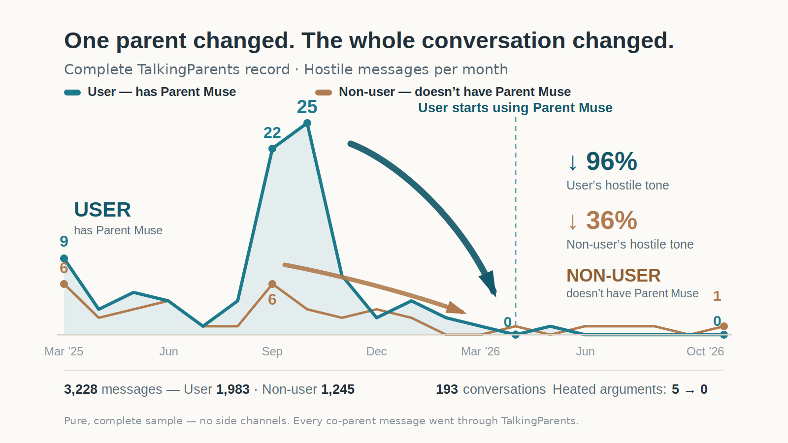

# Parent Muse — Built on Meta AI: Executive Brief

**Product:** Parent Muse, a co-parenting AI agent by M-AI Corp
**Founder:** Benjamin Bryant
**Entry:** Meta Global AI Developer Hackathon (Cerebral Valley)

Parent Muse helps separated parents communicate calmly and stay child-focused. It sits between signing the parenting agreement and the next therapy appointment — there for the 11:30pm moments when a parent is staring at their phone, about to send a message they will regret. Meta AI is not a feature of this product. It is how the product was conceived, built, and runs.

## The engine: Muse Wonder

Parent Muse runs on Muse Wonder via the Meta Model API. Every Ask M answer and every co-parent message draft is generated by Muse, grounded in the family's own parenting plan — the agreement parents already signed — rather than generic advice. The plan is checked first, the relevant section is named in plain language, and responses are coached for de-escalation and child focus before anything is sent.

## The blueprint was written by the engine, for the engine

The rebuild blueprint for Parent Muse was designed by M, a personal AI agent running on the same Muse model that powers the app. M knew the engine's failure modes from the inside — invented plan language, dropped provisions, confident but unsupported citations — and designed the architecture around them: plan-first grounding, section-level citation, and guardrails concentrated on exactly two surfaces, parenting-plan answers and communication with the other parent.

M then supervised the build piece by piece, auditing every delivered piece against the blueprint before it counted as done. The certified final build passes a 242-test suite.

## Built with Manus

Implementation was carried out in Manus under M's supervision, piece by piece against the blueprint. Each piece was verified on delivery — not taken on summary — before the next piece began.

## A memory that serves the parent

Parent Muse carries per-user curated memory — per-child context and co-parent communication patterns — so coaching and drafts reflect the family's actual situation, not a blank slate. That memory is what lets the agent give the *appropriate* response for a specific moment, not just a nice one.

## Distribution: Instagram

Instagram (@getparentmuse) is Parent Muse's public channel and its referral network. Therapists — the product's first audience — are reached there, and every outreach email carries the profile link so clinicians can follow, evaluate, and refer the parents they work with. A Facebook Page (ParentMuse) exists under the same Meta account.

## Demo capture: Ray-Ban Meta

Part of the demo footage was shot on Ray-Ban Meta glasses, capturing the real moments the product is built for — a parent, in their actual day, reaching for help in the moment they need it.

## Results from the founder's own use

Parent Muse was built first for its founder, a father of two, and used in his own co-parenting for six months:

- **Total messages analyzed: 3,228, across 193 conversations**
- Weekly co-parent messages: ~50 → ~19
- Heated arguments: 5 per month → 0
- Hostile messages: down 86%

**Pure data sample:** this is the complete co-parenting record, not a selected sample. Every message went through TalkingParents, with no phone calls or side channels missing from the data. April 2026 is the before/after point for Parent Muse use — about 50 messages a week before, about 19 a week since, and about 12 a week over the last 12 weeks in the record.

---

**Parent Muse was built end-to-end in Meta's AI ecosystem — engine, supervising agent, build, distribution, and capture.**
