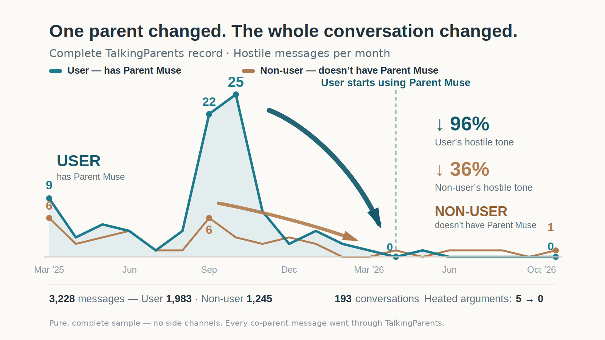

# Parent Muse — a personal AI agent for co-parents, grounded in the family's own parenting plan

Parent Muse is an AI agent for divorced and separated parents. It has memory of the family's situation, coaches the parent in the moment, drafts messages for approval, and answers questions — and every answer is grounded in that family's **actual parenting plan**, not generic advice.

Co-parenting conflict rarely happens in a therapist's office. It happens at 11:30pm, over something small, when a tired parent is staring at their phone about to send a message they will regret. Parent Muse sits between signing the parenting agreement and the next therapy appointment, for exactly those moments.

## How it works

- **Plan-grounded, always.** The family's parenting plan is the standing lens for every answer. Plan answers name the section and explain it in plain language; the agent never invents plan language and never promises legal outcomes.
- **De-escalation first.** The first target is the parent in front of the agent: validate, calm, get child-focused — then act.
- **Mentor-first coaching.** Before any draft, the agent coaches: what is really going on, what the plan says, what outcome serves the kids.
- **BIFF discipline.** Drafts are Brief, Informative, Friendly, and Firm — written to end circular arguments, not win them.
- **Firmness follows the record.** A first ask is soft. If the same important point is ignored repeatedly, drafts get firmer — firmness is earned by the thread record (importance × times ignored), never by the parent's mood. Nothing sends without the parent's approval.

## Try it — live demo app

**https://smithdemo-v5ug9fwn.manus.space/**

A demo clone of the certified production build, seeded with a fictional family — Daniel & Lauren Smith, with children Sophia (11) and Ethan (9) — and a fictional parenting plan written for the demo. It opens straight to the app as Daniel Smith; there is no sign-in wall. Ask it a plan question by voice or text, and watch it answer from the plan, coach, and draft.

## Demo video

**[demo-cut-v8-2026-11-04.mp4](https://github.com/ParentMuse/parent-muse/releases/download/v1.0/demo-cut-v8-2026-11-04.mp4)** (attached to this repo's v1.0 release) — the founder introduces the problem, then four real scenarios run end to end: a schedule change nobody communicated, a therapy-frequency dispute resolved against the plan, a soccer signup with conditions attached, and a summer-schedule standoff that ended without attorneys. Demo footage was partly captured on Ray-Ban Meta glasses.

## Built on Meta AI

Parent Muse runs on **Muse Wonder via the Meta Model API** — the model is the engine for every answer and draft. The build itself was a Meta-stack collaboration: the product blueprint was written by an agent running on the same Muse model, against that engine's known failure modes (invented plan language, dropped provisions, unsupported citations), and that agent audited the builder's code piece by piece before anything counted as done. Distribution runs through Instagram **@getparentmuse**.

Full detail: [`META-TOOLS.md`](META-TOOLS.md) — *Parent Muse — Built on Meta AI: Executive Brief.*

## Founder results

The founder built Parent Muse for his own co-parenting situation and has used it daily. The before/after record is a **pure data sample**: the complete co-parenting message record — 3,228 messages across 193 conversations, March 2025 – October 2026 — with every message through TalkingParents and no side channels missing.

- Weekly co-parent messages: **~50/week → ~19**
- Heated arguments: **5/month → zero**
- Hostile messages: **down 86%**

## Build log & prior work

- [`BUILD-LOG.md`](BUILD-LOG.md) — what was built **during the hackathon window** (Oct 26 – Nov 4, 2026), entry by entry, with test counts, commits, and live-verification gates.
- [`PRIOR-WORK.md`](PRIOR-WORK.md) — the disclosed **prior work**: what existed before the window opened, and how the founder / AI-agent / builder collaboration produced it. The two documents are kept separate on purpose.

## Privacy & IP note

This repo contains demo and fictional-family material only. No real parenting-plan documents, no raw message records, and no real family data are included. The production app's per-family memory layer is part of the company's IP: it is described here by what it does, not blueprinted.

## Team

**M-AI Corp** — founder **Benjamin Bryant**.

Entry: **Meta Global AI Developer Hackathon** (Cerebral Valley) · Startup track · Team ID 1711314040618556.

## License

MIT — see [`LICENSE`](LICENSE).
